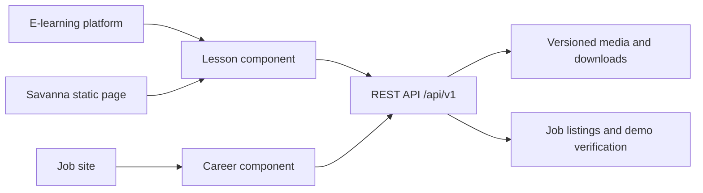

# Access

Access turns one reviewed lesson revision into an accessible media experience that can run inside an existing learning platform or on an independent website. A framework-independent Web Component reads versioned lesson data from a FastAPI service and offers synchronized media, transcripts, downloads and related career resources without taking over the host's enrollment or completion rules.

## Integrate Access



Add the partner site's exact origin (scheme, hostname and port) to the Access server's comma-separated `ACCESS_ALLOWED_ORIGINS`. For the hosted API, coordinate with its operator. Use a site template that permits module scripts and custom elements. If the site has a Content Security Policy, test its script, API connection and media permissions against the Access origin.

### Embed in an e-learning page

Replace the integrity placeholder with the full `lesson.js` value from the [release integrity manifest](https://access-plugin.onrender.com/components/0.1.0/integrity.json). Load the script once per page. Set `lesson-id` and `content-version` to the desired published lesson revision and keep the fallback on that revision.

```html
<script type="module"
  src="https://access-plugin.onrender.com/components/0.1.0/lesson.js"
  integrity="REPLACE_WITH_LESSON_JS_SRI" crossorigin="anonymous"></script>
<alx-accessible-lesson api-base="https://access-plugin.onrender.com/api/v1"
  lesson-id="w3c-colors-with-good-contrast" content-version="1" lang="en">
  <a href="https://access-plugin.onrender.com/api/v1/lessons/w3c-colors-with-good-contrast/downloads/html?version=1">
    Download the lesson transcript
  </a>
</alx-accessible-lesson>
```

See the component on an [independent learning platform](https://access-ethioware.vercel.app/) or generate a snippet in the [interactive installer](https://access-plugin.onrender.com/demo/plug-in).

### Savanna static page example

The [original Savanna concept page](Savanna-static-pages/pages/concept-with-navigation.html) is the layout reference. The [Access integration example](examples/savanna/index.html) mounts the component inside the lesson content area. Try the [hosted Savanna demo](https://access-plugin.onrender.com/demo/savanna), or open `http://127.0.0.1:8000/demo/savanna` after starting Compose.

For this sample, use the e-learning script above with the following element. The relative URLs work when Access serves both the demo page and the API. If you serve a copy on another origin, use absolute Access URLs and configure the allowed origin as described above.

```html
<alx-accessible-lesson api-base="/api/v1"
  lesson-id="alx-transforming-africa" content-version="1" lang="en">
  <a href="/api/v1/lessons/alx-transforming-africa/downloads/html?version=1">
    Download the lesson transcript
  </a>
</alx-accessible-lesson>
```

| Request from the Savanna sample | Purpose |
| --- | --- |
| `GET /api/v1/lessons/alx-transforming-africa/manifest?version=1` | Load the lesson, transcript segments and media references |
| `GET /api/v1/lessons/alx-transforming-africa/exports?version=1` | List the download formats and sizes |
| `GET /api/v1/lessons/alx-transforming-africa/media/video?version=1` | Play the sample lesson video |
| `GET /api/v1/lessons/alx-transforming-africa/downloads/html?version=1` | Open the HTML transcript fallback |

These routes belong to the Access public fixture API. The Savanna sample demonstrates the component mount and leaves enrollment and completion with the host platform.

### Embed in a job site

Use the `jobs.js` integrity value from the same manifest. The component provides job search, support filters and recorded summaries. The hosted demo serves fictional listings and certificates.

```html
<script type="module"
  src="https://access-plugin.onrender.com/components/0.1.0/jobs.js"
  integrity="REPLACE_WITH_JOBS_JS_SRI" crossorigin="anonymous"></script>
<access-career-gateway api-base="https://access-plugin.onrender.com/api/v1">
  <a href="https://access-plugin.onrender.com/api/v1/jobs">View the fictional job data</a>
</access-career-gateway>
```

Try the [Career Gateway demo](https://access-career-gateway.vercel.app/).

### Use the API with your own interface

These public `GET` routes are relative to `/api/v1` and require no learner credentials. Use the same explicit revision across lesson requests. Protected courses require a confirmed host identity integration.

| Route | Response |
| --- | --- |
| `/lessons/{lesson_id}/manifest?version=1` | Lesson metadata, transcript segments and available media |
| `/lessons/{lesson_id}/transcripts/en?version=1` | English transcript, with timestamps when available |
| `/lessons/{lesson_id}/exports?version=1` | Download links, formats, sizes and SHA-256 hashes |
| `/jobs` | Fictional job listings and workplace support |
| `/jobs/{job_id}/structured-data` | Schema.org JobPosting data |
| `/demo-certificates/{identifier}` | Fictional verification status and available course and issue date |

```sh
curl --fail-with-body 'https://access-plugin.onrender.com/api/v1/lessons/w3c-colors-with-good-contrast/manifest?version=1'
curl --fail-with-body 'https://access-plugin.onrender.com/api/v1/jobs'
```

Check HTTP status before rendering results. Show an unavailable state for missing records and offer retry for temporary failures. Use `error.correlation_id` from API error responses when reporting failures. See the [OpenAPI explorer](https://access-plugin.onrender.com/api/docs).

From the actual partner page, verify keyboard transcript seeking and downloads, or job filtering, details and summary playback. Block the script and verify the fallback remains reachable. Check the browser console for CORS, integrity and content-security errors.

## 1. Install Docker and run the project

Docker Compose is the recommended first installation path. It builds the Web Component with Node 24, installs the locked Python 3.11 runtime, and starts the API as a non-root user.

Install [Docker Desktop](https://docs.docker.com/desktop/) on macOS or Windows, or [Docker Engine with the Compose plugin](https://docs.docker.com/engine/install/) on Linux. Start Docker, then verify both the engine and Compose are available:

```sh
docker version
docker compose version
```

Clone the repository with its preserved Savanna reference fixture and start the stack:

```sh
git clone --recurse-submodules https://github.com/ayimmam/Access.git
cd Access
docker compose up --build --detach --wait
curl --fail http://127.0.0.1:8000/healthz
```

For an existing checkout, run `git submodule update --init` before `docker compose up`. Open [http://127.0.0.1:8000/demo/savanna](http://127.0.0.1:8000/demo/savanna) for the main lesson or [http://127.0.0.1:8000/api/docs](http://127.0.0.1:8000/api/docs) for the API. Stop the stack with:

```sh
docker compose down
```

The Compose service is read-only apart from a temporary `/tmp`, mounts the source lesson and Savanna fixture read-only, and exposes only port 8000. Add exact development origins through `ACCESS_ALLOWED_ORIGINS`; wildcard CORS is rejected.

## What the demonstration includes

| Area | Available behavior | Honest boundary |
|---|---|---|
| Accessible lessons | Native video controls, caption selection and sizing, searchable timestamped transcripts, seek actions, audio-only and audio-described alternatives, plus explicit unavailable states | The ALX caption source remains draft; the W3C English captions are source-reviewed while Amharic and Tigrigna translations await human review |
| Sign-language path | A synchronized interpretation-video slot, language-scoped asset manifests, hash/version binding, a local review viewer and a clearly labeled 3D timing prototype | No EthSL recording is shipped; interpreter and Deaf review are still required before calling an asset interpretation |
| Offline and low-data access | Self-contained HTML and text, deterministic ZIP packs with SHA-256 manifests, audio downloads, and PDF/BRF prototypes for the complete-media fixture | PDF/UA, screen-reader and Braille-transcriber verification remain pending; the prototypes are not presented as approved exports |
| Drop-in integration | A reusable `<alx-accessible-lesson>` element, independent-host installer, two-instance isolation, host events, generated SRI metadata, explicit CORS and a versioned `/api/v1` API with OpenAPI docs | Production Savanna identity, enrollment, CSP and course-version contracts are not confirmed |
| Career access | Fictional searchable jobs, local preference filters, keyboard-accessible details, equivalent visible summaries, local read-aloud, matching `schema.org/JobPosting` data and demo certificate states | There are no real employers, applications, learner credentials or Open Badges claims |
| Privacy and recovery | A first-party demo of opaque revocable sessions, CSRF protection, expiry recovery, saved-choice opt-out, data export and account deletion | This is an isolated local demo, not ALX authentication; it requires the separate local setup described in the security documentation |
| Evidence | API, security and browser tests cover failure/retry, lifecycle cleanup, cross-origin installation, keyboard focus, automated axe scans and 320 CSS-pixel reflow | NVDA, TalkBack, co-design approval, full WCAG evaluation and production capacity evidence must still be completed by people |

The media assets and their review state are documented in [the complete-media fixture README](example%20lessons/w3c-contrast/README.md). Current accessibility evidence and gaps are recorded in [WCAG_CONFORMANCE.md](docs/WCAG_CONFORMANCE.md); neither document is a blanket conformance claim.

## Demonstration routes

| Route | Purpose |
|---|---|
| `/demo/savanna` | Savanna-style host with the supplied ALX video, draft captions, transcript, downloads and optional timing prototype |
| `/demo/independent` | Two independent lesson-component instances and fallback behavior |
| `/demo/plug-in` | Install, theme, remove and copy a pinned independent-host embed |
| `/demo/ethioware` | A second provider-style host using the same component and API |
| `/demo/careers` | Fictional career gateway and accessible job details |
| `/demo/certificates/DEMO-LEARNING-001` | Explicitly fictional valid, revoked and unknown verification states |
| `/demo/privacy` | Local session and privacy-control demonstration; setup is required |
| `/demo/avatar-review` | Load local draft motion studies and export timestamped co-design feedback |
| `/api/docs` | Interactive documentation for the public fixture API |

The static sites under `demos/` are separately deployable provider showcases. They are tested with `npm run test:vercel-demos` and are not production account integrations.

## How the code is organized

```text
host page
  -> packages/lesson-component (Web Components and component-owned UI)
  -> services/api              (HTTP, validation, CORS and safe errors)
  -> services/core             (lesson, export, job and asset-binding rules)
  -> approved fixtures/assets  (versioned public demonstration content)
```

| Path | Responsibility | Status |
|---|---|---|
| `packages/lesson-component/` | Lesson, media, signing-review and career Web Components | Active |
| `services/core/` | Immutable lesson models, exports, jobs and signing-asset binding | Active |
| `services/api/` | FastAPI routes, OpenAPI, security/privacy demo and static examples | Active |
| `services/worker/` | Optional offline motion capture and draft avatar tooling | Partial; queued conversion is pending |
| `examples/` | API-served Savanna, independent, installer, privacy and career examples | Active |
| `demos/` | Standalone provider showcase sites | Active |
| `integrations/savanna/` | Boundary for fixture mapping and a future production adapter | Production contract pending |
| `fixtures/` and `example lessons/` | Approved, non-personal test and media content | Active; preserve source review labels |
| `tests/` and `services/api/tests/` | Browser, API, accessibility and security automation | Active; human evidence remains separate |
| `apps/`, `contracts/` | Reserved staff console, hosted offline reader and extracted contracts | Scaffolded |
| `infra/` | Container and deployment documentation around the root Compose setup | Active documentation |
| `docs/` | Architecture, planning, security, setup and evidence | Active |
| `Savanna-static-pages/` | Preserved upstream reference fixture | Do not edit for integrations |

See [CODEBASE_STRUCTURE.md](docs/architecture/CODEBASE_STRUCTURE.md) for ownership and dependency boundaries, and [the documentation index](docs/README.md) for deeper guides.

## Native development

Use Node 24 or later, Python 3.11, npm and uv. From the repository root:

```sh
git submodule update --init
npm ci
npm run build
uv sync --locked
uv run python -m access_core.offline_video
uv run uvicorn access_api.main:app --reload --host 127.0.0.1 --port 8000
```

The offline video build uses FFmpeg to create MP4s with language-tagged selectable subtitles under `artifacts/offline-video/`. The Docker build generates these automatically.

Keep `example lessons/` beside the service because the public fixture repository reads those approved local assets. The [avatar runbook](docs/architecture/AVATAR_BLUEPRINT_EVALUATION.md) documents the optional capture dependency group and local review flow.

## Verification

Run the checks relevant to the files you change:

```sh
npm run build
npm run typecheck
uv run pytest
npx playwright install chromium
npm run test:browser
npm run test:vercel-demos
python3 scripts/check_repository.py
git diff --check
```

Playwright browser installation is a one-time machine setup. Automated results support review but do not replace assistive-technology, co-design, content-review or whole-page conformance evidence.

## Project boundaries

The current service publishes public fixtures. ALX has not confirmed production authentication, enrollment, completion, content-ingest or deployment contracts, so the component never treats host markup, captured cookies or playback as proof of identity or completion. Generated captions, sign assets, PDFs and Braille remain unavailable to learners until their exact source revision and required human review are recorded.

Start implementation decisions with [the Track 2 plan](docs/planning/TRACK_2_IMPLEMENTATION_PLAN.md), follow [CONTRIBUTING.md](CONTRIBUTING.md), and apply the repository [security rules](.agents/rules/security.md).
